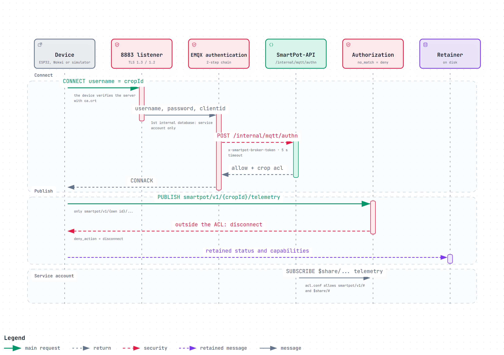
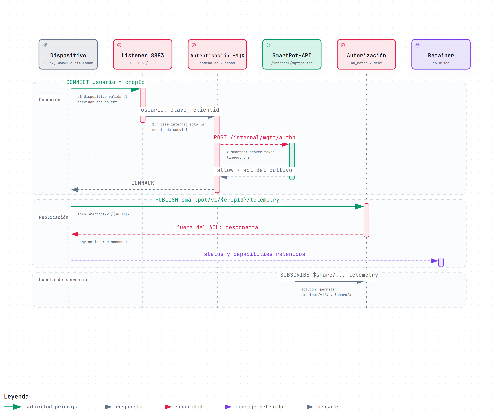

# SmartPot-Broker · Interactive Diagrams

[English](#english) | [Español](#español)

---

## English

Each diagram is a self-contained HTML page that works offline. Download it and open it in a browser to zoom, search nodes, trace a path and jump to the exact source lines on GitHub. The PNG preview is the light-theme render of the same diagram.

### 1. Device Connection and Per-Crop ACL

A device connects to the 8883 TLS listener with username = crop ID. EMQX first checks its internal database, which only holds the API service account, and then calls `POST /internal/mqtt/authn` on SmartPot-API with the shared `x-smartpot-broker-token`. The API answers with the permission and an ACL limited to `smartpot/v1/{cropId}/...`; anything outside it is denied and the session is disconnected. Retained `status` and `capabilities` are stored on disk, and the API service account subscribes to `$share/...` telemetry thanks to the `/tmp/acl.conf` rule written by the entrypoint.

- Interactive: [English](SmartPot_Broker_A1_Device_Authentication_Sequence.en.html) · [Spanish](SmartPot_Broker_A1_Device_Authentication_Sequence.es.html)
- Sources: `config/emqx.conf.template`, `docker-entrypoint.sh` and `README.md` at commit `620d86f`.

---

## Español

Cada diagrama es una página HTML autocontenida que funciona sin conexión. Descárgala y ábrela en un navegador para ampliar, buscar nodos, seguir un recorrido y saltar a las líneas exactas del código en GitHub. La vista previa PNG es el mismo diagrama en tema claro.

### 1. Conexión de un dispositivo y ACL por cultivo

Un dispositivo se conecta al listener TLS 8883 con usuario = id del cultivo. EMQX revisa primero su base interna, que solo guarda la cuenta de servicio de la API, y después llama a `POST /internal/mqtt/authn` de SmartPot-API con el `x-smartpot-broker-token` compartido. La API responde con el permiso y un ACL limitado a `smartpot/v1/{cropId}/...`; lo que quede fuera se niega y se corta la sesión. `status` y `capabilities` retenidos se guardan en disco, y la cuenta de servicio de la API se suscribe a la telemetría `$share/...` gracias a la regla de `/tmp/acl.conf` que escribe el entrypoint.

- Interactivo: [inglés](SmartPot_Broker_A1_Device_Authentication_Sequence.en.html) · [español](SmartPot_Broker_A1_Device_Authentication_Sequence.es.html)
- Fuentes: `config/emqx.conf.template`, `docker-entrypoint.sh` y `README.md` en el commit `620d86f`.

